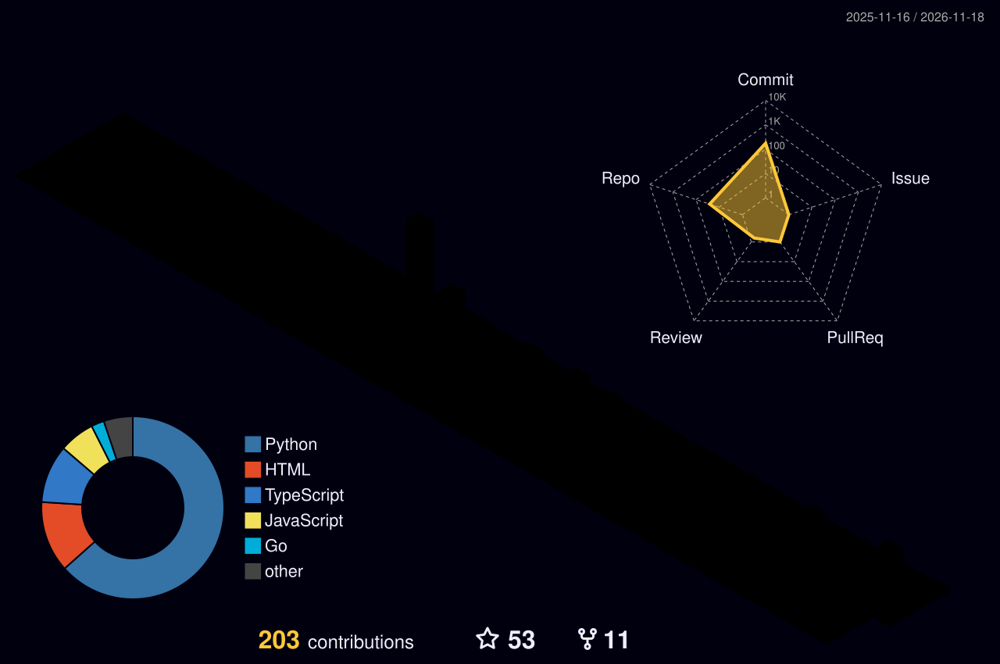

  

  

  
  
  
  

## About Me · 个人简介

Hi, I'm **Terre (海二旺)** — a **Shenzhen-based Senior Frontend & Full-Stack Engineer (8+ years)** and **AI Product Builder**.

- **Personal Website / 个人作品主页**：👉 **[https://aaoi.cc.cd](https://aaoi.cc.cd)**（在线履历、代表项目与工具入口）
- **Core Expertise / 核心方向**：
  - **DTC Independent Store & Frontend**：React / Vue / Next.js / Nuxt.js SSR、**Shopify Online Store 2.0 (Liquid / Sections / Schema)**、Headless (Storefront API / Hydrogen)、Core Web Vitals 性能优化、GTM / GA4 转化埋点与多语言 `i18n`。
  - **Full-Stack & Cross-Platform**：TypeScript、Node.js / Cloudflare Workers、微信小程序 / Taro / uni-app、复杂 B2B 交易结算与配置化组件库。
  - **AI Engineering & Automation**：多 Agent 工程工作流、内容/自媒体自动化流水线（[声稿工坊](https://studio.aaoi.cc.cd)）、Skills & MCP 工具治理。
- **Status / 当前状态**：现居深圳，开放 **独立站前端开发（Shopify / DTC） / 全栈与 AI 应用工程** 全职及合作机会。

  
  
  
  
  

  
  
  
  
  
  
  
  
  
  

## Live Metrics

  
  
  
  

## Contribution Visuals

  

  <picture>
    <source media="(prefers-color-scheme: dark)" srcset="https://github.com/outhsics/outhsics/raw/main/profile-snake-contrib/github-snake-dark.svg" />
    <source media="(prefers-color-scheme: light)" srcset="https://github.com/outhsics/outhsics/raw/main/profile-snake-contrib/github-snake.svg" />
    
  </picture>

## Flagship Projects

| Project | Visual Card |
|---|---|
| [Terre Portfolio (aaoi.cc.cd)](https://aaoi.cc.cd) |   |
| [openfang-auto-clip](https://github.com/outhsics/openfang-auto-clip) |    |
| [ai-skills-control-kit](https://github.com/outhsics/ai-skills-control-kit) |    |
| [upload-test-file-generator](https://github.com/outhsics/upload-test-file-generator) |    |
| [ui-diff-tool](https://github.com/outhsics/ui-diff-tool) |    |
| [TrendRadar](https://github.com/outhsics/TrendRadar) |    |
| [react-schema-form-lite](https://github.com/outhsics/react-schema-form-lite) |    |

## Stack

`TypeScript` `React` `Vue` `Next.js` `Nuxt.js` `Shopify Online Store 2.0 / Liquid` `Node.js` `Cloudflare Workers` `GTM / GA4` `Python` `GitHub Actions` `AI Tooling`

## Open-Source Operating System

- [GitHub Brand Playbook](./GITHUB_BRAND_PLAYBOOK.md)
- [Project Index](./PROJECT_INDEX.md)
- [Open Source Ops Guide (EN)](./OPEN_SOURCE_OPERATIONS_GUIDE.en.md)
- [开源运营指南（中文）](./OPEN_SOURCE_OPERATIONS_GUIDE.zh-CN.md)
- [README Status Block Template](./templates/README_STATUS_BLOCK.md)
- [Repo Bootstrap Checklist](./templates/REPO_BOOTSTRAP_CHECKLIST.md)

## Contact

- Personal Website: [https://aaoi.cc.cd](https://aaoi.cc.cd)
- GitHub: [@outhsics](https://github.com/outhsics)
- Email: `outhsics@gmail.com`
